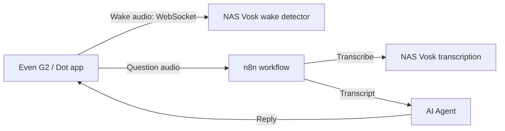
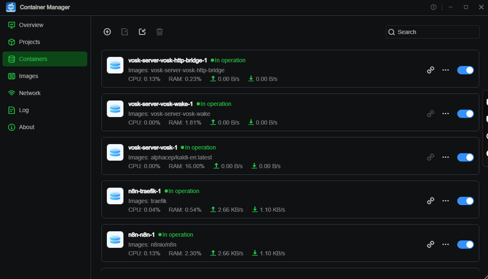
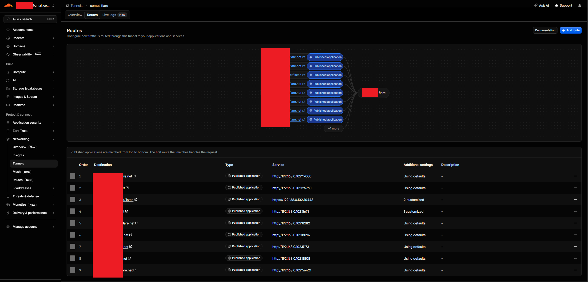
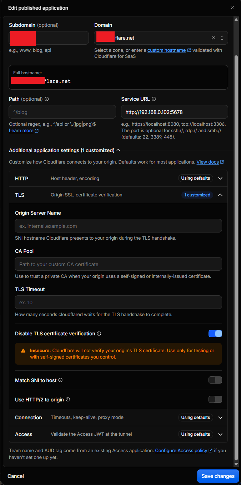
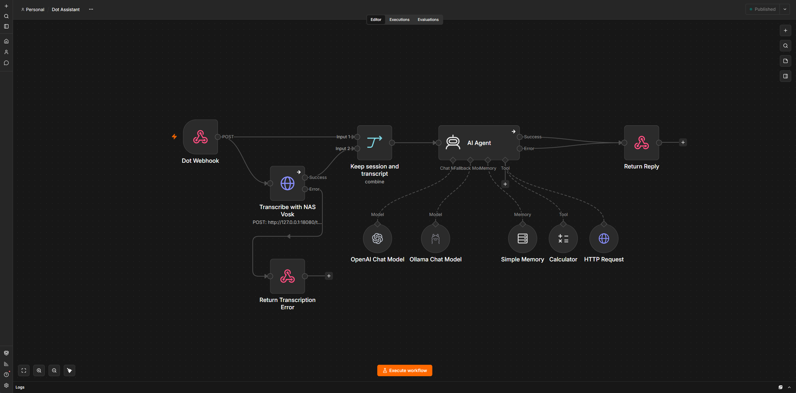

# Dot for Even G2

Dot is a voice assistant starter app for Even G2. It listens for “Hey Dot” using a self-hosted Vosk wake-word service, records a question, and sends the audio to an n8n workflow. n8n sends the audio to Vosk for transcription, passes the transcript to an AI Agent, and returns the answer to the app.



## How it works

- When Dot opens inside the Even Realities app, it creates the glasses display and starts wake-word listening. Allow microphone access when prompted. Keep Dot in the foreground; the app stops listening when it goes to the background or closes.
- After Vosk detects “Hey Dot,” Dot records your question. It sends the recording to n8n after about 1.2 seconds of silence, or when the 30-second recording limit is reached.
- After a reply, a 20-second follow-up window lets you start another question without saying “Hey Dot” again. The glasses footer shows a live countdown. If you do not start speaking before it expires, wake-word listening resumes.
- The last answer stays on the display until the next wake phrase. Answers longer than the display area are split into pages. Tap the glasses text to advance, long-press to go back, or double-tap to close the page. The desktop preview has page buttons.
- The lens footer identifies the current state, such as `LISTENING FOR HEY DOT`, `LISTENING FOR QUESTION`, `FOLLOW-UP OPEN (20S)`, or `PROCESSING`. The animated processing dots are part of the desktop preview; the physical display keeps its current text while the app waits for the reply.

While waiting for “Hey Dot,” microphone audio is streamed to the NAS wake detector for recognition. Question audio is not sent to n8n until the app records a question and finishes capturing it. During the follow-up window, the app uses local audio-level detection to start capturing speech; that audio is not sent to the wake detector.

On a desktop, run the preview and click **Start Hey Dot** to use the PC microphone. The preview simulates the glasses display and does not connect to G2. A separate manual recording control is available as a fallback.

## Requirements

- Even G2 glasses and the Even Realities app for device testing.
- Node.js 20 or newer and npm.
- Even Hub CLI to package the app.
- Your own n8n instance, with credentials for the AI model you configure.
- A Linux NAS or server with Docker Compose v2 for the Vosk services and HTTP/WebSocket bridge.
- A reverse proxy or tunnel that publishes the bridge's `/listen` route over secure WebSockets (`wss://`) with a certificate trusted by the phone.

## Configure the app

1. Copy `.env.local.example` to `.env.local`.
2. Set these values:
   - `VITE_N8N_WEBHOOK_URL`: the production URL of the activated Dot workflow's webhook.
   - `VITE_VOSK_STREAM_URL`: the secure WebSocket URL ending in `/listen`, such as `wss://your-host.example.com/listen`.
   - `VITE_VOSK_STREAM_TOKEN`: a long random token shared with the NAS bridge.

3. Edit `app.json`:
   - Set `package_id` to a unique reverse-domain identifier you own.
   - Add the HTTPS origins for the n8n webhook host and Vosk WebSocket host to the network permission whitelist. If both services share a host, one origin is enough.

Generate a token on Linux with `openssl rand -hex 32`. In Windows PowerShell, use:

```powershell
$bytes = New-Object byte[] 32
$rng = [Security.Cryptography.RandomNumberGenerator]::Create()
$rng.GetBytes($bytes)
[BitConverter]::ToString($bytes).Replace('-', '').ToLower()
$rng.Dispose()
```

Use the same token in `.env.local` and the NAS `.env`. Values prefixed with `VITE_` are embedded in the app build and can be extracted by an app user. Treat the stream token as a basic access gate, not as a secret that can secure a public endpoint by itself. Do not commit `.env.local` or the NAS `.env`.

## Set up the NAS Vosk services

Copy these files from this repository to a directory on the NAS. You do not need to copy the entire repository or your n8n installation.

```text
vosk-server/
|-- docker-compose.vosk.yml
|-- .env
|-- vosk-wake/
|   `-- Dockerfile
`-- vosk-http-bridge/
    |-- Dockerfile
    |-- requirements.txt
    `-- app.py
```

Create `.env` beside `docker-compose.vosk.yml` using `n8n/.env.example` as a template. Set:

- `VOSK_STREAM_TOKEN` to the same token used in the app's `.env.local`.
- `VOSK_PUBLIC_HOST` to the hostname used for the `/listen` WebSocket route.
- `TRAEFIK_HTTPS_ENTRYPOINT` to your reverse proxy's HTTPS entrypoint name if you use Traefik (often `websecure`).

Start the services from the directory containing the Compose file:

```sh
docker compose -f docker-compose.vosk.yml up -d --build
curl http://127.0.0.1:18080/health
```

The health check should return `{"ok":true}`. The Compose stack runs separate Vosk services for wake-word recognition and question transcription. The bridge exposes `/listen` for authenticated wake detection and `/transcribe` for WAV transcription. Its HTTP port is bound to NAS loopback at `127.0.0.1:18080` by default.



The example Traefik labels assume Traefik uses host networking on the same NAS and route `https://<VOSK_PUBLIC_HOST>/listen` to `http://127.0.0.1:18080`. If your proxy runs elsewhere or uses a Docker bridge network, adjust the route and bridge address so the proxy can reach the service. For a tunnel, configure a published application route to the bridge's reachable HTTP address and `/listen` path. The public route must support WebSocket upgrades and present a trusted TLS certificate. Do not expose the unauthenticated `/transcribe` endpoint to the public internet.

### Cloudflare Tunnel (optional)

If you use Cloudflare Tunnel, add a published application route for your chosen hostname and the `/listen` path.



Point its origin to an HTTP address that the tunnel connector can reach, either the Vosk bridge or a reverse proxy that forwards `/listen` to it. The app should use `wss://<your-hostname>/listen` for `VITE_VOSK_STREAM_URL`; the public connection must allow WebSocket upgrades. The bridge is bound to loopback by default, so make sure the tunnel connector or reverse proxy has a network path to it. Keep `/transcribe` private.



## Set up n8n

1. Import `n8n/dot-assistant-workflow.json` into your n8n instance.
2. Configure the model credentials and nodes for your environment. The template uses OpenAI (`gpt-5-mini`) as the primary chat model and Ollama (`gpt-oss:20b`) as its fallback. It does not use Google Gemini. The workflow also includes a calculator and a weather lookup tool.
3. In **Transcribe with NAS Vosk**, set an address that n8n can reach.
4. Activate the workflow and copy its production Dot Webhook URL to `VITE_N8N_WEBHOOK_URL` in `.env.local`.

The webhook receives multipart form data with an `audio` WAV file, `sessionId`, `source`, and `timestamp`. It returns JSON containing `transcript` and `reply`.

The template's transcription URL is `http://127.0.0.1:18080/transcribe`. This works when n8n uses host networking on the same NAS as the bridge. If n8n is in a Docker bridge network, put it and the bridge on a shared network and use the bridge service name, for example `http://vosk-http-bridge:8080/transcribe`. n8n Cloud cannot reach a NAS loopback address; configure a secured, reachable transcription endpoint and update the HTTP Request node. Keep `/transcribe` protected from unauthenticated public access.



## Run and package the app

Install dependencies and start the local preview:

```sh
npm install
npm run dev -- --host 0.0.0.0
```

Open the Vite URL in a desktop browser, click **Start Hey Dot**, and grant microphone permission. The PC microphone tests the recording and webhook flow; wake detection still requires a reachable NAS Vosk WebSocket endpoint.

Build and package the app with Even Hub CLI:

```sh
npm run build
npx evenhub pack app.json dist -o dot-assistant.ehpk --sdk-ver 0.0.16
```

Install the package through the Even Realities app's private-build flow or your usual Even Hub testing process. After changing `.env.local`, rebuild and repackage so the new values are included.

## Privacy and troubleshooting

- While wake listening is active, microphone audio streams to the NAS wake detector. After a wake match, the app captures the question locally and uploads it to the n8n webhook when speech ends. Follow-up audio is detected locally during the 20-second window.
- Use **Stop listening** to stop the microphone and wake stream. The app also stops listening when it goes to the background or closes.
- If the app stays on **Connecting**, check the public `/listen` WSS route, TLS certificate, stream token on both sides, and NAS bridge logs.
- If wake detection works but questions fail, check that n8n can reach `/transcribe`, the HTTP Request node uses the right address, and the Vosk transcription service is running.
- Set n8n execution-history and binary-data retention to suit your privacy needs.
- Never commit credentials, `.env.local`, the NAS `.env`, or private production URLs.

## License

No license is included yet. Add a license that matches how you want others to reuse this project before inviting public contributions.
